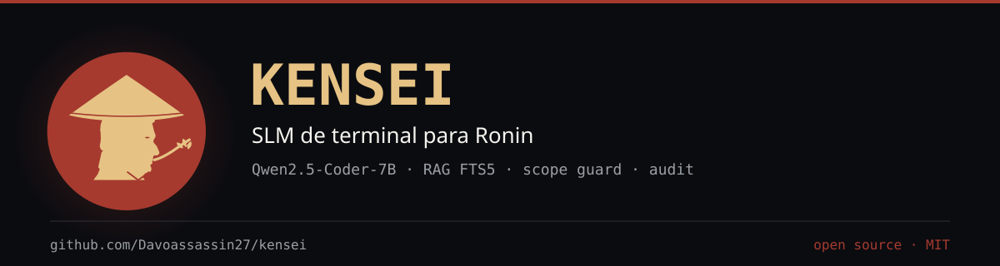

# Kensei — agente de terminal con SLM local

**Observa, propone, ejecuta y verifica.** Kensei es un agente de terminal que corre contra Ollama, con un guard de alcance que falla cerrado y auditoría de cada tool-call.

No es un chatbot que “sabe comandos”: es un harness con un bucle cerrado `observar → proponer → ejecutar → verificar`, memoria documental local y confirmación humana antes de tocar el sistema.

[](LICENSE)
[](LICENSE-DOCS)
[](pyproject.toml)
[](https://ollama.com)
[](tests)
[](https://github.com/Davoassassin27/kensei/actions/workflows/ci.yml)
[](#estado)

> [!NOTE]
> **v0.1.0 usable hoy.** La suite local pasa 81 tests. El modelo servido es Qwen2.5-Coder-7B (variante abliterada Q4_K_M) + system prompt + RAG; el LoRA de conducta es el siguiente hito, no un requisito para probar el harness.

## Inicio rápido

Requisitos: Python 3.11+, [uv](https://docs.astral.sh/uv/) y Ollama con un modelo local.

```bash
git clone https://github.com/Davoassassin27/kensei.git
cd kensei
uv sync --extra dev

ollama serve
ollama pull qwen2.5-coder:7b
uv run python scripts/create_base_model.py --base qwen2.5-coder:7b --name kensei

cp config/scope.example.yaml ~/.config/kensei/scope.yaml
uv run kensei doctor
```

Probá el bucle sin ejecutar nada:

```bash
uv run kensei ask "systemd no levanta nginx, diagnosticá"
uv run kensei auto "enumerá SMB en 192.168.1.10"    # propone y confirmás
uv run kensei ask "..." --execute                   # ejecuta herramientas
```

Sin `--execute`, la ejecución es **dry-run**. El modelo puede proponer; el guard y vos deciden.

## Qué hace

| Comando | Función |
| --- | --- |
| `kensei ask "..."` | una pregunta o tarea; respuesta y tool-calls propuestos |
| `kensei auto "..."` | agente human-in-the-loop: propone, editás y confirmás |
| `kensei chat` | sesión interactiva con historial |
| `kensei recall "..."` | búsqueda FTS5 en la memoria documental |
| `kensei index` | construye el índice RAG desde chunks |
| `kensei scope` | muestra el alcance activo y el estado de autorización |
| `kensei doctor` | diagnóstico de Ollama, modelo, scope y guard |

## Scope y seguridad

El alcance vive en `~/.config/kensei/scope.yaml`. El ejemplo de Kensei es **global** (`0.0.0.0/0`, `::/0`, `domains: ["*"]`) porque es el modo de operación de Ronin; para un lab o CTF usá [`config/scope.lab.example.yaml`](config/scope.lab.example.yaml).

```yaml
engagement: "global-authorized"
authorized: true
targets:
  cidrs: ["0.0.0.0/0", "::/0"]
  domains: ["*"]
deny:
  cidrs: []
  domains: []
```

Reglas duras:

- **Falla cerrado:** sin `authorized: true`, cualquier comando de red se rechaza.
- **El guard es determinista:** `rm -rf /`, `mkfs`, `dd` sobre discos, fork bombs y borrado de subvolúmenes se bloquean sin posibilidad de confirmar.
- **Riesgo alto:** `iptables`, `mount`, `snapper delete`, pipe-to-shell y reverse shells requieren confirmación explícita.
- **Dry-run por defecto:** `--execute` es obligatorio para ejecutar herramientas.
- **Auditoría:** cada decisión se escribe en `~/.local/state/kensei/audit.jsonl`.
- **Scope global no es barra libre:** solo contra sistemas propios o con autorización escrita. El bloqueo destructivo sigue activo.

`kensei doctor` reporta `guard_public: WARN` cuando el scope es global. Es el comportamiento esperado, no un fallo: avisa que el alcance no está acotado.

## Arquitectura

| Capa | Qué hace | Tecnología |
| --- | --- | --- |
| **Kensei Core** | persona, protocolo de tool-calls, criterio de diagnóstico | Qwen2.5-Coder-7B + prompt de sistema; LoRA QLoRA en camino |
| **Kensei Memory** | hechos y procedimientos de Arch Wiki, HackTricks, PayloadsAllTheThings, THR, tldr y GTFOBins | SQLite FTS5 sobre corpus local |
| **Kensei Hands** | ejecuta comandos con guard, confirmación y auditoría | CLI Python + Ollama |
| **Kensei Dojo** | mide si el modelo realmente sirve | casos determinísticos + sandbox |

El corpus no se versiona: se descarga con `scripts/fetch_sources.py` y se normaliza localmente. El LoRA enseña **conducta**; el RAG aporta **hechos actuales**. Un modelo de 7B no puede memorizar cientos de MB de documentación sin olvidar el resto.

## Modelo y datos

- **Base de entrenamiento:** [`Qwen/Qwen2.5-Coder-7B-Instruct`](https://huggingface.co/Qwen/Qwen2.5-Coder-7B-Instruct) — Apache-2.0.
- **Modelo servido hoy:** [`bartowski/Qwen2.5-Coder-7B-Instruct-abliterated-GGUF`](https://huggingface.co/bartowski/Qwen2.5-Coder-7B-Instruct-abliterated-GGUF) Q4_K_M + prompt de Kensei.
- **Pesos y corpus:** no se distribuyen desde este repositorio. HackTricks es **CC BY-NC 4.0**; THR y GTFOBins son GPL-3.0; Arch Wiki es GFDL-1.3. Revisá [NOTICE](NOTICE) y [docs/DATASETS.md](docs/DATASETS.md) antes de publicar cualquier derivado.

El adaptador LoRA entrenado con este corpus se considera **privado** hasta revisar esas licencias.

## Marca

Kensei es una sub-marca de Ronin: comparte el perfil, la kasa y el trigo; el bermellón `#A63A2F` y el oro `#E6C384` identifican a la herramienta. Los assets oficiales están en [`brand/`](brand/), con guía de uso y tamaños mínimos en [`brand/README.md`](brand/README.md).

## Relación con Ronin

Kensei es un **proyecto separado** con su propio repositorio y branding. Ronin lo integra en el build con [`65-kensei.sh`](https://github.com/Davoassassin27/ronin/blob/main/build/guest/65-kensei.sh): instala la shell zsh/TUI, el CLI, el RAG manual y `kensei-model.service`. Si el código no está vendorizado en `kensei/`, el build lo clona desde este repositorio usando `KENSEI_REPO` y `KENSEI_REF`.

- Ronin: https://github.com/Davoassassin27/ronin
- Kensei: https://github.com/Davoassassin27/kensei

## Estado

- **Hecho:** CLI (`ask`, `auto`, `chat`, `recall`, `index`, `scope`, `doctor`), shell zsh/TUI, guard de alcance, auditoría JSONL, RAG FTS5, creación del modelo base y 81 tests.
- **En curso:** LoRA de conducta con QLoRA, dataset SFT y Dojo de evaluación.
- **No incluido:** pesos fine-tune, corpus crudo, claves, scope real y reportes de cliente.

Roadmap y decisiones en [docs/PLAN.md](docs/PLAN.md), [docs/DECISIONS.md](docs/DECISIONS.md) y [docs/MODEL-CARD.md](docs/MODEL-CARD.md).

## Documentación

| Documento | Para qué |
| --- | --- |
| [docs/TUI.md](docs/TUI.md) | shell, TUI, instalación en Ronin y troubleshooting |
| [docs/SAFETY.md](docs/SAFETY.md) | modelo de amenazas, guard y flujo de ejecución |
| [docs/DATASETS.md](docs/DATASETS.md) | fuentes, licencias y pipeline de datos |
| [docs/TRAINING.md](docs/TRAINING.md) | receta QLoRA y requisitos de GPU |
| [docs/EVAL-BASELINE.md](docs/EVAL-BASELINE.md) | baseline del modelo y casos del Dojo |
| [docs/MODEL-CARD.md](docs/MODEL-CARD.md) | uso previsto, límites y sesgos |

## Contribuir

- Abrí un issue con el comando, el scope (sin datos sensibles) y la salida de `kensei doctor`.
- Para cambios de código: `uv run pytest` y `uv run ruff check src tests`.
- No incluyas credenciales, corpus con licencias incompatibles, pesos ni reportes de terceros.

## Licencia

- **Código:** [MIT](LICENSE).
- **Documentación y marca:** [CC BY 4.0](LICENSE-DOCS).
- **Corpus, datasets y pesos:** licencias de sus fuentes; no se distribuyen. Ver [NOTICE](NOTICE).

Mantenido por [@Davoassassin27](https://github.com/Davoassassin27).
